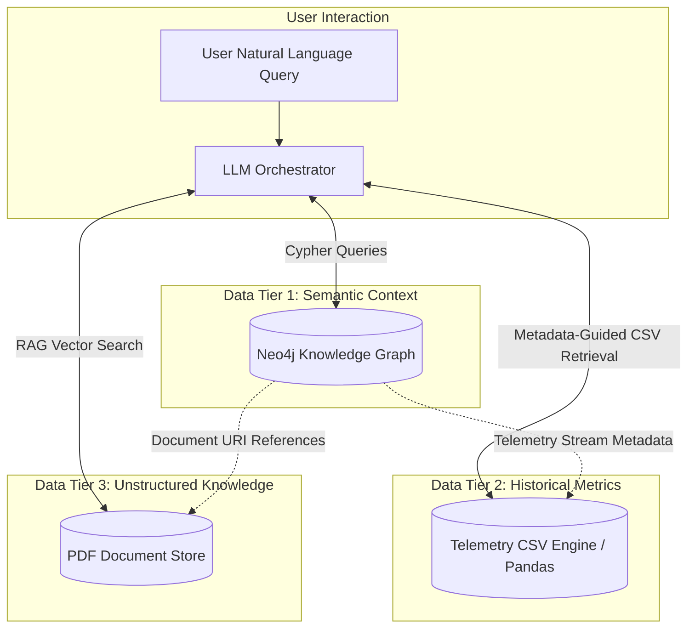

# Asset Intelligence Platform — Neo4j Knowledge Graph Ontology Specification

**Document Version:** 1.1.0  
**Status:** Implemented Schema Specification  
**Scope:** Neo4j Semantic Knowledge Graph  
**System Role:** Core Semantic Memory Layer  

---

## 1. Project Overview

The **Asset Intelligence Platform** is an enterprise-grade AI system designed to provide intelligent, multi-modal answers to complex natural language inquiries regarding facility infrastructure, HVAC systems, building assets, telemetry health, maintenance logs, and technical manuals.

The platform relies on a hybrid data retrieval architecture that decouples structural semantics, high-frequency time-series data, and unstructured documentation:

1. **Neo4j Knowledge Graph (Semantic Layer)**: Stores entities, physical and organizational hierarchies, sensor metadata, health states, warranties, contracts, and references to external files.
2. **Telemetry Engine (CSV / Pandas)**: Manages high-frequency historical sensor readings (e.g., Supply Air Temperature, Return Air Temperature, Fan RPM, Energy Consumption, Differential Pressure, Humidity).
3. **Technical Document Store (RAG / Vector DB)**: Houses unstructured PDF documents (O&M manuals, warranty certificates, service logs, engineering schematics) accessible via Retrieval-Augmented Generation (RAG).

This document serves as the **official schema specification** for the implemented Neo4j Knowledge Graph ontology.

---

## 2. High-Level Architecture

The LLM Orchestrator retrieves context across all three data tiers before generating structured, factual responses.



---

## 3. Entity Catalog

The Knowledge Graph consists of **17 core node labels**. Node properties are implementation-specific and determined by the Neo4j database schema.

### 3.1 Organization
* **Description**: Represents the top-level corporate or institutional entity owning or operating facilities.
* **Properties**: Implementation-specific. Refer to the Neo4j database schema for the current property set.
* **Relationships**:
  * Outgoing: `[:HAS_FACILITY]->(Facility)`, `[:EMPLOYS]->(Technician)`
  * Incoming: None

### 3.2 Facility
* **Description**: A physical building, site, or campus under an Organization.
* **Properties**: Implementation-specific. Refer to the Neo4j database schema for the current property set.
* **Relationships**:
  * Outgoing: `[:HAS_SPACE]->(Space)`, `[:HAS_DOCUMENT]->(Document)`
  * Incoming: `(Organization)-[:HAS_FACILITY]->`

### 3.3 Space
* **Description**: A specific zone, room, floor, or functional area within a Facility.
* **Properties**: Implementation-specific. Refer to the Neo4j database schema for the current property set.
* **Relationships**:
  * Outgoing: `[:HAS_ASSET]->(Asset)`
  * Incoming: `(Facility)-[:HAS_SPACE]->`, `(Asset)-[:SERVES]->`

### 3.4 Asset
* **Description**: Primary physical equipment or machinery (e.g., Air Handling Unit - AHU-01).
* **Properties**: Implementation-specific. Refer to the Neo4j database schema for the current property set.
* **Relationships**:
  * Outgoing: `[:HAS_COMPONENT]->(Component)`, `[:HAS_SENSOR]->(Sensor)`, `[:SERVES]->(Space)`, `[:HAS_DOCUMENT]->(Document)`, `[:HAS_HEALTH]->(HealthStatus)`, `[:HAS_STATE]->(OperatingState)`, `[:MANUFACTURED_BY]->(Manufacturer)`, `[:HAS_WARRANTY]->(Warranty)`, `[:HAS_MAINTENANCE]->(MaintenanceRecord)`
  * Incoming: `(Space)-[:HAS_ASSET]->`, `(ServiceContract)-[:COVERS]->`

### 3.5 Component
* **Description**: Sub-assembly or modular part constituting an Asset (e.g., Supply Fan, Cooling Coil, Filter Section).
* **Properties**: Implementation-specific. Refer to the Neo4j database schema for the current property set.
* **Relationships**:
  * Outgoing: `[:HAS_SENSOR]->(Sensor)`, `[:MANUFACTURED_BY]->(Manufacturer)`, `[:HAS_DOCUMENT]->(Document)`
  * Incoming: `(Asset)-[:HAS_COMPONENT]->`, `(MaintenanceRecord)-[:SERVICED]->`

### 3.6 Sensor
* **Description**: Physical measurement device attached to an Asset or Component.
* **Properties**: Implementation-specific. Refer to the Neo4j database schema for the current property set.
* **Relationships**:
  * Outgoing: `[:MEASURES]->(TelemetryStream)`
  * Incoming: `(Asset)-[:HAS_SENSOR]->`, `(Component)-[:HAS_SENSOR]->`

### 3.7 TelemetryStream
* **Description**: Graph metadata node defining an external CSV telemetry file or stream reference.
* **Properties**: Implementation-specific. Refer to the Neo4j database schema for the current property set.
* **Relationships**:
  * Outgoing: `[:CAN_TRIGGER]->(Alarm)`
  * Incoming: `(Sensor)-[:MEASURES]->`

### 3.8 OperatingState
* **Description**: Represents current or recorded operational status of an Asset.
* **Properties**: Implementation-specific. Refer to the Neo4j database schema for the current property set.
* **Relationships**:
  * Outgoing: None
  * Incoming: `(Asset)-[:HAS_STATE]->`

### 3.9 HealthStatus
* **Description**: Dynamic risk assessment or condition score of an Asset derived from analytics.
* **Properties**: Implementation-specific. Refer to the Neo4j database schema for the current property set.
* **Relationships**:
  * Outgoing: None
  * Incoming: `(Asset)-[:HAS_HEALTH]->`

### 3.10 Alarm
* **Description**: Represents threshold breaches, abnormal conditions, or fault alerts triggered by telemetry.
* **Properties**: Implementation-specific. Refer to the Neo4j database schema for the current property set.
* **Relationships**:
  * Outgoing: None
  * Incoming: `(TelemetryStream)-[:CAN_TRIGGER]->`

### 3.11 Manufacturer
* **Description**: Original Equipment Manufacturer (OEM) producing Assets or Components.
* **Properties**: Implementation-specific. Refer to the Neo4j database schema for the current property set.
* **Relationships**:
  * Outgoing: None
  * Incoming: `(Asset)-[:MANUFACTURED_BY]->`, `(Component)-[:MANUFACTURED_BY]->`

### 3.12 Document
* **Description**: Metadata reference node pointing to an external PDF document indexed for RAG.
* **Properties**: Implementation-specific. Refer to the Neo4j database schema for the current property set.
* **Relationships**:
  * Outgoing: None
  * Incoming: `(Asset)-[:HAS_DOCUMENT]->`, `(Facility)-[:HAS_DOCUMENT]->`, `(Component)-[:HAS_DOCUMENT]->`

### 3.13 Warranty
* **Description**: Guarantee agreement covering Assets against defects or failure.
* **Properties**: Implementation-specific. Refer to the Neo4j database schema for the current property set.
* **Relationships**:
  * Outgoing: None
  * Incoming: `(Asset)-[:HAS_WARRANTY]->`

### 3.14 Vendor
* **Description**: External service provider, distributor, or maintenance contractor.
* **Properties**: Implementation-specific. Refer to the Neo4j database schema for the current property set.
* **Relationships**:
  * Outgoing: `[:PROVIDES]->(ServiceContract)`, `[:EMPLOYS]->(Technician)`
  * Incoming: None

### 3.15 ServiceContract
* **Description**: Formal maintenance or service agreement governing asset upkeep.
* **Properties**: Implementation-specific. Refer to the Neo4j database schema for the current property set.
* **Relationships**:
  * Outgoing: `[:COVERS]->(Asset)`
  * Incoming: `(Vendor)-[:PROVIDES]->`

### 3.16 Technician
* **Description**: Skilled personnel who perform inspections, maintenance, or service procedures.
* **Properties**: Implementation-specific. Refer to the Neo4j database schema for the current property set.
* **Relationships**:
  * Outgoing: None
  * Incoming: `(Organization)-[:EMPLOYS]->`, `(Vendor)-[:EMPLOYS]->`, `(MaintenanceRecord)-[:PERFORMED_BY]->`

### 3.17 MaintenanceRecord
* **Description**: Historical log entry of service, repair, inspection, or replacement work performed on specific Components.
* **Properties**: Implementation-specific. Refer to the Neo4j database schema for the current property set.
* **Relationships**:
  * Outgoing: `[:PERFORMED_BY]->(Technician)`, `[:SERVICED]->(Component)`
  * Incoming: `(Asset)-[:HAS_MAINTENANCE]->`

---

## 4. Relationship Catalog

The graph features **19 explicitly defined relationship types**.

| # | Source Node | Relationship Type | Target Node | Cardinality | Business Description |
|---|-------------|-------------------|-------------|-------------|----------------------|
| 1 | `Organization` | `HAS_FACILITY` | `Facility` | 1 : N | Connects an enterprise organization to its physical facilities/buildings. |
| 2 | `Facility` | `HAS_SPACE` | `Space` | 1 : N | Maps physical spaces, rooms, or floors within a specific building facility. |
| 3 | `Space` | `HAS_ASSET` | `Asset` | 1 : N | Pinpoints physical location of an asset inside a designated space. |
| 4 | `Asset` | `HAS_COMPONENT` | `Component` | 1 : N | Breaks down an asset into its constituent sub-assemblies or modular parts. |
| 5 | `Asset` / `Component` | `HAS_SENSOR` | `Sensor` | 1 : N | Links physical equipment or components to monitoring sensors. |
| 6 | `Sensor` | `MEASURES` | `TelemetryStream` | 1 : 1 | Associates a physical sensor with its telemetry metadata stream/file. |
| 7 | `TelemetryStream` | `CAN_TRIGGER` | `Alarm` | 1 : N | Defines fault conditions or threshold alerts tied to a telemetry stream. |
| 8 | `Asset` | `SERVES` | `Space` | N : M | Specifies which physical spaces or zones receive service from an asset (e.g., AHU-01 serving Conference Room). |
| 9 | `Asset` / `Facility` / `Component` | `HAS_DOCUMENT` | `Document` | N : M | Connects physical entities to related technical manuals, drawings, or reports. |
| 10 | `Asset` | `HAS_HEALTH` | `HealthStatus` | 1 : 1 | Binds an asset to its current calculated health condition grade. |
| 11 | `Asset` | `HAS_STATE` | `OperatingState` | 1 : 1 | Binds an asset to its current runtime operating state. |
| 12 | `Asset` / `Component` | `MANUFACTURED_BY` | `Manufacturer` | N : 1 | Identifies the OEM responsible for manufacturing an asset or component. |
| 13 | `Asset` | `HAS_WARRANTY` | `Warranty` | 1 : N | Links an asset to its active or historic warranty policies. |
| 14 | `Asset` | `HAS_MAINTENANCE` | `MaintenanceRecord` | 1 : N | Connects an asset to historical maintenance records. |
| 15 | `MaintenanceRecord` | `PERFORMED_BY` | `Technician` | N : 1 | Attributes a maintenance record to the technician who executed the work. |
| 16 | `MaintenanceRecord` | `SERVICED` | `Component` | N : M | Connects a maintenance record to the specific component that was serviced. |
| 17 | `Vendor` | `PROVIDES` | `ServiceContract` | 1 : N | Links external vendors to the service contracts they provide. |
| 18 | `ServiceContract` | `COVERS` | `Asset` | N : M | Defines which assets are covered under a specific service contract SLA. |
| 19 | `Vendor` / `Organization` | `EMPLOYS` | `Technician` | 1 : N | Identifies the employer (Organization or Vendor) of a technician. |

---

## 5. Graph Design Principles

1. **Strict Separation of Concerns**: High-volume, millisecond-interval sensor readings are stored in **CSV files**, keeping Neo4j lean and dedicated purely to topology, metadata, and semantic relationships.
2. **Component-Level Maintenance Modeling**: Maintenance activities are attached to assets via `(Asset)-[:HAS_MAINTENANCE]->(MaintenanceRecord)` and linked to specific target components via `(MaintenanceRecord)-[:SERVICED]->(Component)`, ensuring precise maintenance tracking at sub-assembly granularity.
3. **Metadata Indexing for Multi-Modal Retrieval**: Nodes such as `TelemetryStream` and `Document` hold external file references (`file_path`), enabling the LLM Orchestrator to pivot from semantic graph context directly into Pandas time-series queries or PDF RAG chunking.
4. **Traceability & Root Cause Pathing**: The path `(Asset)-[:HAS_COMPONENT]->(Component)-[:HAS_SENSOR]->(Sensor)-[:MEASURES]->(TelemetryStream)-[:CAN_TRIGGER]->(Alarm)` allows immediate path traversal from an active alarm back to the specific component, asset, space, manufacturer, service contract, and maintenance logs.

---

## 6. Example Graph Traversals (Cypher Queries)

The following Cypher queries are written to execute against the demonstration dataset (`Tiramai Technologies`, `Bommanahalli Office`, `AHU-01`, etc.).

### Query 1: Retrieve Asset Context, Component Hierarchy, Sensors & Served Spaces for Bommanahalli Office
```cypher
MATCH (o:Organization {name: "Tiramai Technologies"})-[:HAS_FACILITY]->(f:Facility {name: "Bommanahalli Office"})
MATCH (f)-[:HAS_SPACE]->(mech:Space {name: "Second Floor Mechanical Room"})-[:HAS_ASSET]->(a:Asset {id: "AHU-01"})
MATCH (a)-[:HAS_COMPONENT]->(c:Component)
OPTIONAL MATCH (c)-[:HAS_SENSOR]->(s:Sensor)-[:MEASURES]->(ts:TelemetryStream)
OPTIONAL MATCH (a)-[:SERVES]->(servedSpace:Space)
RETURN a.id AS AssetID, 
       c.name AS ComponentName, 
       s.name AS SensorName, 
       ts.file_path AS TelemetryFile, 
       servedSpace.name AS ServedZone;
```

### Query 2: Find Maintenance Records, Serviced Components, and Technicians for AHU-01
```cypher
MATCH (a:Asset {id: "AHU-01"})-[:HAS_MAINTENANCE]->(mr:MaintenanceRecord)
MATCH (mr)-[:SERVICED]->(c:Component)
MATCH (mr)-[:PERFORMED_BY]->(tech:Technician)
RETURN a.id AS AssetID, 
       mr.id AS MaintenanceRecordID, 
       c.name AS ServicedComponent, 
       tech.name AS TechnicianName;
```

### Query 3: Trace Telemetry Alarms to Specific Components and Maintenance History
```cypher
MATCH (ts:TelemetryStream)-[:CAN_TRIGGER]->(alm:Alarm)
MATCH (s:Sensor)-[:MEASURES]->(ts)
MATCH (c:Component)-[:HAS_SENSOR]->(s)
MATCH (a:Asset)-[:HAS_COMPONENT]->(c)
OPTIONAL MATCH (a)-[:HAS_MAINTENANCE]->(mr:MaintenanceRecord)-[:SERVICED]->(c)
OPTIONAL MATCH (mr)-[:PERFORMED_BY]->(tech:Technician)
RETURN a.id AS AssetID, 
       c.name AS Component, 
       alm.id AS AlarmID, 
       ts.file_path AS TelemetryFile, 
       tech.name AS Technician;
```

---

## 7. Future Extension Points

* **BMS Protocol Connectors**: Extending `TelemetryStream` metadata to map directly to BACnet Object IDs or Modbus registers for real-time telemetry streaming.
* **GraphRAG Vector Embeddings**: Storing node/subgraph embeddings inside Neo4j for hybrid vector-graph similarity searches.
* **Spatial GIS Hierarchy**: Enhancing `Facility` and `Space` nodes with geo-coordinates and IFC/BIM spatial standards.

---

## 8. Repository Structure

The Asset Intelligence Platform project follows a modular layout designed to maintain a clear separation of concerns across Knowledge Graph interaction, telemetry processing, document indexing, and LLM orchestration.

```
AssetIntelligence/
├── graph/
│   ├── ontology.md
│   ├── neo4j_client.py
│   ├── graph_queries.py
│
├── telemetry/
│   ├── ahu_telemetry.csv
│   ├── telemetry_reader.py
│
├── documents/
│
├── llm/
│   └── orchestrator.py
│
├── main.py
│
└── requirements.txt
```

### Module Responsibilities

* **`graph/`**: Contains the Neo4j database connection client (`neo4j_client.py`), Cypher query execution handlers (`graph_queries.py`), and the official graph ontology documentation (`ontology.md`).
* **`telemetry/`**: Stores historical sensor time-series data (`ahu_telemetry.csv`) and Python modules (`telemetry_reader.py`) to load, filter, and aggregate telemetry using Pandas.
* **`documents/`**: Serves as the repository for technical PDF manuals, warranties, service contracts, and engineering schematics used by the RAG subsystem.
* **`llm/`**: Houses the LLM Orchestrator (`orchestrator.py`) responsible for multi-source data retrieval across Neo4j, Telemetry, and Documents, prompt construction, and final natural language answer synthesis.
* **`main.py`**: The primary application entry point for running the platform CLI and interactive user queries.
* **`requirements.txt`**: Specifies all required Python dependencies (e.g., `neo4j`, `pandas`, `langchain`/`llamaindex`, `pydantic`).
